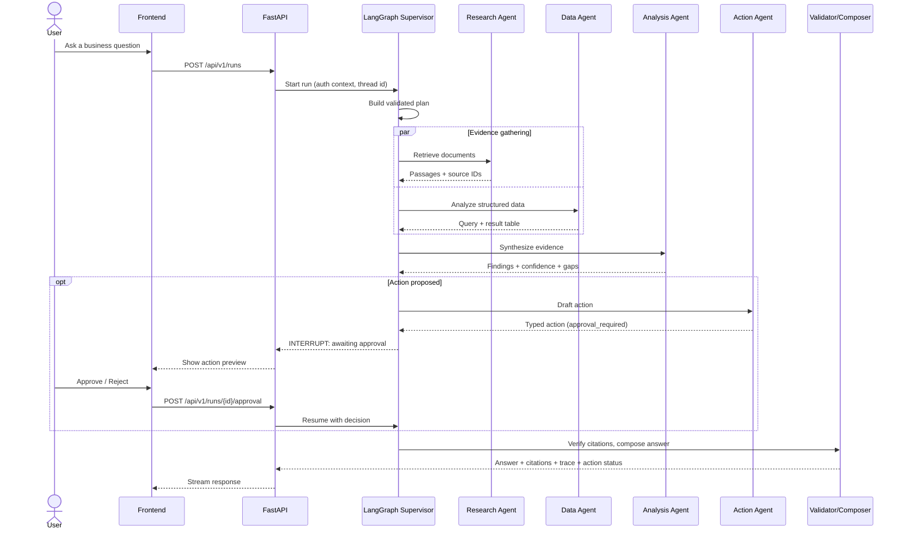
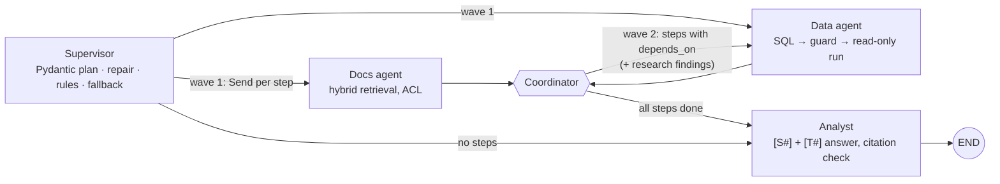

# Architecture

> This is the **target architecture**. Components are built phase by phase; see [ROADMAP.md](ROADMAP.md) for what exists today.

## 1. Request lifecycle



## 2. Components

| Component | Responsibility | Key constraints |
| --- | --- | --- |
| **Frontend** | Conversation, citation previews, execution trace, approval panel | Never holds tool credentials |
| **FastAPI backend** | Auth, validation, streaming, run management | Enforces permissions and approvals itself |
| **Supervisor** | Interprets intent, decomposes tasks, routes, stops | Plan validated by a Pydantic schema; bounded iterations |
| **Research Agent** | Hybrid retrieval + reranking + citations | Permission filter applied before generation |
| **Data Agent** | Text-to-SQL over approved schemas | Read-only role, allow-list, timeout, row limit |
| **Analysis Agent** | Combines evidence, flags gaps and contradictions | Correlation ≠ causation; explicit confidence |
| **Action Agent** | Proposes typed tool calls via MCP adapters | Cannot execute without recorded approval |
| **Validator / Composer** | Checks every citation maps to a stored passage | Unverifiable claims are labeled, not hidden |

## 3. Retrieval pipeline (Phase 2, implemented)

```
Upload / seed ─▶ Parse (md, txt, pdf, docx) + front matter (doc_id, title, acl, version)
              ─▶ Heading-aware chunks (heading path, ≤220 words, sentence overlap)
              ─▶ Embed "heading path + text" (text-embedding-3-small | offline hashing)
              ─▶ documents + chunks (generated weighted tsvector, vector(1536))

Question ─▶ (+ previous question for short follow-ups)
         ─▶ ┬─ pgvector cosine top-20   WHERE acl && caller_groups AND same embedding model ─┐
            └─ FTS ts_rank top-20       WHERE acl && caller_groups ─────────────────────────┴▶ RRF (k=60)
         ─▶ [optional LLM rerank] ─▶ top-6 numbered sources [S1..S6]
         ─▶ grounded prompt ─▶ answer ─▶ citation check (drop markers to unknown sources)
         ─▶ response: answer + sources + validated citations; run audit row
```

See [ADR 0002](adr/0002-hybrid-retrieval-in-postgres.md) for the reasoning and measured trade-offs.

## 4. Multi-agent graph (Phase 3, implemented)



- **State** is plain JSON (question, history, caller groups, plan, research results, tables, trace), so LangGraph's **Postgres checkpointer** stores it after every step. The run id is the thread id; `POST /agent/runs/{id}/resume` continues a failed run without repeating completed steps.
- **Retries:** transient DB errors retry with backoff (node retry policy); the analyst retries once on model errors and resets streamed text. Logical failures are handled in the node: plan repair (once), SQL repair (up to 3 attempts with the error), then a reviewed query, then a reported failure that the analyst must acknowledge.
- **Trace:** every node returns an event (status `succeeded` / `fallback` / `failed`, start time, duration, summary, detail such as SQL, attempts, or plan rules), persisted on `agent_runs` and shown as a waterfall in the UI.

### SQL safety layers

```
model SQL ─▶ validate_sql (sqlglot, postgres dialect)
             • one statement · SELECT/UNION only · no INTO / FOR UPDATE / data-modifying CTEs
             • tables ∈ analytics.{customers, onboarding_events, verification_checks, support_tickets}
             • functions ∈ allow-list (aggregates, window, date, math, text)
             • LIMIT ≤ SQL_MAX_ROWS enforced
          ─▶ SQLExecutor: SET TRANSACTION READ ONLY · SET LOCAL ROLE analytics_reader
             · SET LOCAL statement_timeout · fetchmany(max_rows + 1) · always ROLLBACK
```

`analytics_reader` is `NOLOGIN` with `USAGE` on the analytics schema and `SELECT` on its tables only. Privileges are checked when a statement starts, so a statement can't widen its own access, and the rollback reverts any session setting. See [ADR 0003](adr/0003-multi-agent-graph-and-safe-sql.md).

## 5. Data model

| Table | Purpose |
| --- | --- |
| `documents` | Source document metadata, version, ACL, content hash, embedding model *(implemented)* |
| `chunks` | Chunk text, heading path, generated `tsvector`, `vector(1536)`, FK to document *(implemented)* |
| `chat_runs` | One row per run: status, latency, tokens, retrieved chunks, validated citations *(implemented)* |
| `agent_runs` | One row per multi-agent run: plan, trace, sources, tables (SQL + rows), citations, latency *(implemented)* |
| `checkpoint*` | LangGraph state after every step, created by `AsyncPostgresSaver.setup()` *(implemented)* |
| `analytics.*` | `customers`, `onboarding_events`, `verification_checks`, `support_tickets` (synthetic, read via `analytics_reader`) *(implemented)* |
| `actions` | Proposed actions, approval decision, executor result (audit log) *(Phase 4)* |

## 6. Trust boundaries

1. **User ↔ backend:** authenticated; every request carries a user and role context.
2. **LLM ↔ tools:** the LLM only *proposes* tool calls. The backend validates arguments, checks permissions, and requires approval for high-impact actions.
3. **Data Agent ↔ database:** model SQL is validated, then executed read-only as `analytics_reader`, which can only see the analytics schema.
4. **Retrieved content ↔ LLM:** retrieved text is treated as untrusted data, which is why prompt-injection tests are part of the eval suite.

## 7. Decisions

Significant decisions are recorded as ADRs in [`adr/`](adr/).
