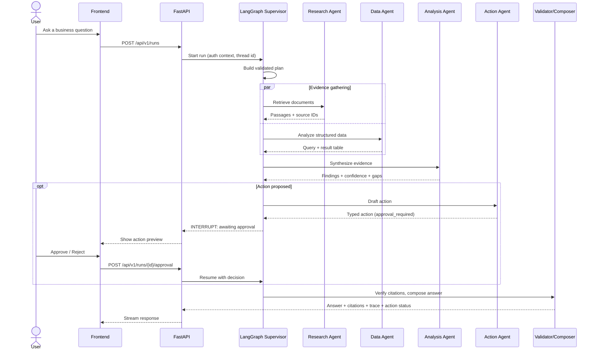

# Architecture

> This is the **target architecture**. Components are built phase by phase; see [ROADMAP.md](ROADMAP.md) for what exists today.

## 1. Request lifecycle



## 2. Components

| Component | Responsibility | Key constraints |
| --- | --- | --- |
| **Frontend** | Conversation, citation previews, execution trace, approval panel | Never holds tool credentials |
| **FastAPI backend** | Auth, validation, streaming, run management | Enforces permissions and approvals itself |
| **Supervisor** | Interprets intent, decomposes tasks, routes, stops | Plan validated by a Pydantic schema; bounded iterations |
| **Research Agent** | Hybrid retrieval + reranking + citations | Permission filter applied before generation |
| **Data Agent** | Text-to-SQL over approved schemas | Read-only role, allow-list, timeout, row limit |
| **Analysis Agent** | Combines evidence, flags gaps and contradictions | Correlation ≠ causation; explicit confidence |
| **Action Agent** | Proposes typed tool calls via MCP adapters | Cannot execute without recorded approval |
| **Validator / Composer** | Checks every citation maps to a stored passage | Unverifiable claims are labeled, not hidden |

## 3. Retrieval pipeline (Phase 2)

```
Upload ─▶ Extract & clean ─▶ Chunk (+doc_id, section, page, version, acl)
       ─▶ Embed ─▶ Store (Postgres: text + tsvector + vector)

Query ─▶ ┬─ pgvector similarity (top-k)   ─┐
         └─ Postgres full-text (top-k)     ─┴▶ RRF fusion ─▶ Cross-encoder rerank
                                              ─▶ ACL filter ─▶ Passages w/ stable IDs
```

## 4. Data model (initial sketch)

| Table | Purpose |
| --- | --- |
| `documents` | Source document metadata, version, ACL |
| `chunks` | Chunk text, `tsvector`, `vector`, location, FK to document |
| `runs` | One row per assistant run (user, status, timings, cost) |
| `run_steps` | Agent/tool steps for the execution trace |
| `actions` | Proposed actions, approval decision, executor result (audit log) |
| `checkpoints` | LangGraph state persistence |
| *demo schema* | `customers`, `onboarding_events`, `support_tickets`, `issues`, `operational_metrics` (synthetic) |

## 5. Trust boundaries

1. **User ↔ backend:** authenticated; every request carries a user and role context.
2. **LLM ↔ tools:** the LLM only *proposes* tool calls. The backend validates arguments, checks permissions, and requires approval for high-impact actions.
3. **Data Agent ↔ database:** a dedicated read-only role limited to the demo schema.
4. **Retrieved content ↔ LLM:** retrieved text is treated as untrusted data, which is why prompt-injection tests are part of the eval suite.

## 6. Decisions

Significant decisions are recorded as ADRs in [`adr/`](adr/).
